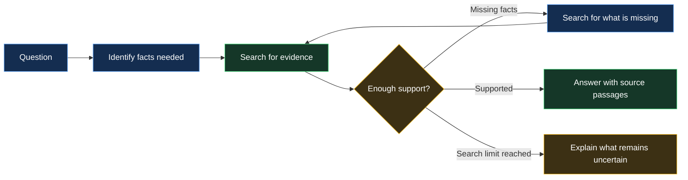

# Our RAG observations

Keep adding our observations and experiment ideas here. An idea becomes a finding only after we test it.

## 2026-11-06 — Retrieve neighboring chunks instead of repeating overlap

### What I am noticing

Some questions need only one marked evidence passage. My impression is that two or three nearby chunks may give enough information to answer these questions. We have not measured how often that is true.

In our first inspected question, one chunk already contained all the expected evidence, but it ranked sixth and was excluded by our top-five search.

### The idea

Instead of repeating about 50 tokens between every pair of chunks, create chunks without overlap. When search selects a chunk, also fetch the chunk immediately before it and the one immediately after it in the same document.

```text
Previous chunk  +  Search-selected chunk  +  Next chunk
                   read together
```

“Previous” and “next” mean document order, not search rank. At the start or end of a document, only fetch the neighbor that exists.

### Why it might help

We could store and embed less repeated text, while still bringing nearby context back when needed. An explanation that crosses a chunk boundary could be read together.

### What we need to check

- Search must first select a useful chunk. We cannot use the known answer to choose it. A useful neighbor can recover missed evidence, but this is not guaranteed.
- Evidence may be farther away or in another section. Three adjacent chunks will not always contain everything needed.
- Extra neighboring text may improve recall while lowering precision. Returning more text also increases later answer-generation cost.
- If two selected chunks share neighbors, include each source range only once.

### Experiment to try later

Compare our current **480-token chunks with 50-token overlap** against **480-token chunks with no overlap, followed by previous/next expansion**. Keep the model, documents, and questions fixed. Changing chunk boundaries requires a separate set of embeddings.

Record both how many chunks search selects and how much text is returned after expansion. Compare quality at a similar returned-text budget, alongside preparation time, search time, and storage.

Status: observation and proposed experiment; no pipeline change made yet.

## 2026-11-06 — Plan searches and check whether evidence is sufficient

### My proposed approach

When a question needs several pieces of evidence, use an LLM to turn it into smaller search questions. Retrieve evidence for those questions, then use a ReAct-style loop to check what is still missing and search again before answering.

Example: “Can this agreement be terminated, and what notice is required?” might need separate searches for termination rights, notice periods, and exceptions.



### Assessment

This is a reasonable experiment for questions needing different facts or dependent searches. It is not required merely because the benchmark marks several passages: one query can already retrieve multiple passages. A longer passage may instead need neighboring chunks or a wider context window.

Two useful options to compare separately:

- **Plan first:** generate different subquestions up front when the needed facts are already clear.
- **Search, then follow up:** let retrieved information guide the next query when the next fact cannot be known in advance.

### What the research supports

- [IRCoT](https://arxiv.org/abs/2212.10509) alternates retrieval and intermediate reasoning for questions requiring multiple steps. Its experiments support using newly retrieved information to guide later searches; they do not establish gains on our CUAD setup.
- [ReAct](https://arxiv.org/abs/2210.03629) alternates reasoning, actions, and observations. Retrieval can be one of those actions. ReAct itself is not a guarantee that every required fact has been found.
- [Adaptive-RAG](https://arxiv.org/abs/2403.14403) chooses retrieval strategies based on question complexity. This supports testing extra searches where needed rather than requiring them for every question.
- [Self-RAG](https://arxiv.org/abs/2310.11511) studies retrieval and critique using a specially trained model with reflection tokens. An ordinary prompted LLM checking our evidence would be a related experiment, not a reproduction of Self-RAG.

### How we could test it

Keep our current search as the baseline. First test query planning alone, then add the follow-up loop separately. Reuse the same document embeddings.

For each fact needed, record a supporting source passage or mark it missing, ambiguous, or contradicted. Keep the agreement identity in follow-up searches. Merge duplicate evidence, and set limits on search rounds, returned text, time, and model usage. If support remains insufficient, report the gap rather than treating the LLM's confidence as proof.

The planner and evidence checker must not see the benchmark's expected passages or our correct-rank diagnostic. Those are available only afterward for evaluation. Compare final evidence precision/recall, actual answer support, latency, number of searches, and model cost. A longer search loop might find more evidence while also returning more irrelevant text.

Status: proposed experiment informed by research; neither query planning nor an LLM evidence-checking loop has been implemented or evaluated here.

## 2026-11-06 — Rewrite the user's question before searching

### The idea

The user's wording may differ from the language used in contracts. Use an LLM to turn the question into clearer search wording, while preserving what the user means.

Example:

- User asks: “When does this deal run out?”
- Search rewrite: “What is the agreement's expiration date or the end date of its initial term?”

This is **query rewriting**: expressing the same question differently. It is separate from breaking a question into different facts that need their own searches.

### Suggested approach

Keep the original question and generate one or two alternative search questions. Search with each, combine the results, remove duplicates, and rank the combined candidates before choosing the final passages.

The rewriter should preserve the supplied agreement identity, parties, dates, and conditions. Resolve references such as “this agreement” from the conversation or selected document when available; do not guess when the reference is unclear. Introduce useful alternative wording, such as “expiration,” “initial term,” and “duration,” without inventing an answer or adding unsupported facts.

### What to test

Compare **original only**, **rewrite only**, and **original plus rewrite**. Keep the documents, embedding model, and final returned-text budget the same. Record precision, recall, the expected evidence's rank, latency, and rewriting cost.

A rewrite can change the question's meaning or make retrieval worse. A lower cosine distance alone does not prove improvement; check whether the expected evidence was actually found. The rewriter must not see the benchmark's marked answers or correct-rank diagnostics.

### Research connection

[Query Rewriting for Retrieval-Augmented Large Language Models](https://aclanthology.org/2023.emnlp-main.322/) studies a rewrite–retrieve–read approach. This supports testing rewriting, but does not establish that our proposed original-plus-rewrite method will improve this CUAD experiment.

Status: recorded experiment idea; query rewriting has not been implemented or evaluated here.
