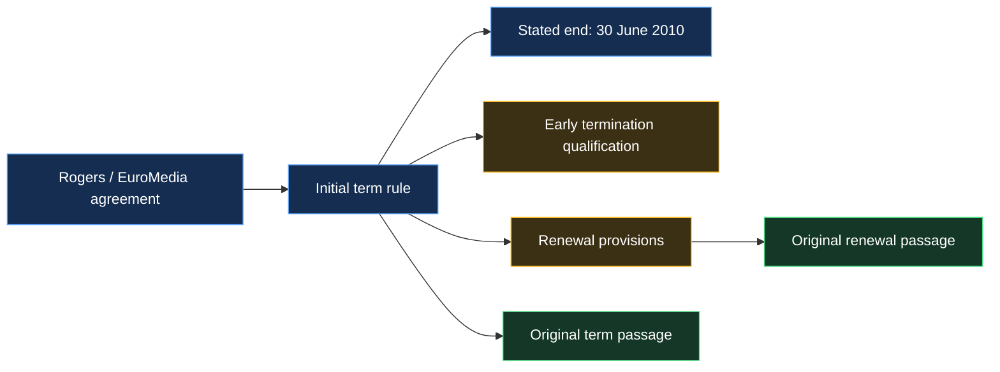
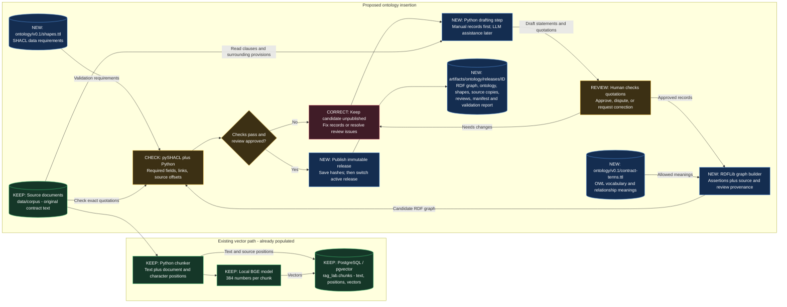
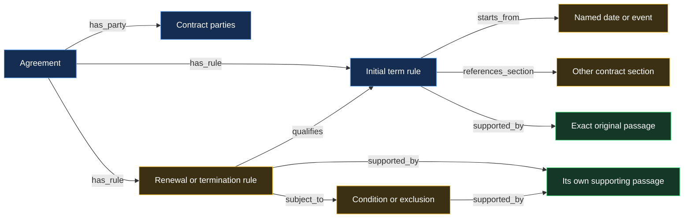

# Our first ontology: contract term and expiry

Draft design · 2026-11-12. This document proposes the next experiment. The ontology, tables, and commands described below have not been built.

## 1. What we want it to do

Answer one question well: **“When does this agreement end, and what conditions could change that?”**

Our ontology will be a small map of meanings connected to original text. Search follows the map and returns evidence. It must distinguish a scheduled initial end date from renewal, early termination, or an end date we cannot establish.

Start with five development contracts. Review explicit statements against their quotations; keep uncertain legal interpretations pending. We are testing retrieval, not claiming automated legal judgment.

## 2. Five real examples we inspected

These examples come from our existing 100-contract selection. IDs are the original CUAD question IDs (`source_index`); ranges are start-inclusive, end-exclusive character positions in the UTF-8 text read by our current pipeline. Each quoted benchmark passage was checked against its source, and nearby text was inspected too.

| Example | What the inspected text says | What our map must represent |
| --- | --- | --- |
| **10 — Rogers / EuroMedia**. Evidence `6970–7157`. | Initial term ends **30 June 2010**, unless ended earlier. Following text gives Rogers a two-year renewal option and discusses continued distribution after expiry. | Store the initial date and the linked qualifications. Do not present it as an unconditional final end date. |
| **30 — PSiTech / Empirical Ventures**. Evidence `17382–17622`. | Initial term lasts **five years after the Effective Date**. Following text describes an automatic three-year renewal unless non-renewal notice is given. | Store a duration and its starting reference, plus a separate renewal condition. Do not guess a date from the filing date. |
| **129 — Eton / Aucta**. Evidence `36378–37095`. | Effectiveness depends on specified events; ending refers to **Section 11**. | Keep the conditions and section reference. The marked passage alone does not give a fixed end date. Retrieve the referenced provisions before interpreting it. |
| **268 — T-Mobile / Elephant Talk**. Evidence `53741–53935`. | Initial period is **redacted as `***`**, measured from Commercial Launch Date, and subject to article 18. | Record that the duration is redacted, preserve the starting event and cross-reference, and report the missing information. |
| **373 — Johns Hopkins / Virtuoso**. Evidence `11714–11913`. | Term ends when the last relevant patent expires **in each country**. Nearby clauses describe earlier termination. | Store an event-based ending and country scope. A calendar date needs additional patent facts. |

**Design consequence:** a single `end_date` field is insufficient. We need different kinds of term rule: **fixed date, duration from a reference, event-based, and cross-reference**, with an explicit status for missing or redacted information.

Exact source files, relative to `data/corpus/`:

```text
10:  cuad/EuromediaHoldingsCorp_20070215_10SB12G_EX-10.B(01)_525118_EX-10.B(01)_Content License Agreement.txt
30:  cuad/GopageCorp_20140221_10-K_EX-10.1_8432966_EX-10.1_Content License Agreement.txt
129: cuad/EtonPharmaceuticalsInc_20191114_10-Q_EX-10.1_11893941_EX-10.1_Development Agreement.txt
268: cuad/PareteumCorp_20081001_8-K_EX-99.1_2654808_EX-99.1_Hosting Agreement.txt
373: cuad/VirtuosoSurgicalInc_20191227_1-A_EX1A-6 MAT CTRCT_11933379_EX1A-6 MAT CTRCT_License Agreement.txt
```

## 3. The small map we will build

| Thing | Plain meaning |
| --- | --- |
| **Agreement** | The specific contract, with a stable identity |
| **Source passage** | Exact text, document version, and character positions |
| **Term rule** | A statement about when a term starts or ends |
| **Condition / event** | Something affecting that rule, such as renewal or patent expiry |
| **Assertion** | A proposed or reviewed statement connecting these things, with its evidence and author |

Start with connections such as `has_term_rule`, `supported_by`, `starts_from`, `subject_to`, and `references_section`. A review can later classify a qualification as `exception_to` or a documented replacement as `replaces`; do not infer these just because two statements differ.

Example 10 becomes:



The diagram shows a proposed representation of inspected text, not a determination that renewal occurred. Assertions and connections retain their own supporting ranges. They can cross chunk boundaries.

## 4. How OWL 2, PROV-O, and SHACL fit

These have different jobs; they are not three databases.

| Standard | Our use | What it cannot establish |
| --- | --- | --- |
| **[OWL 2](https://www.w3.org/TR/owl2-syntax/)** | Define the vocabulary and relationships in `contract-terms.ttl`, with an ontology version identifier. | Legal correctness or automatic resolution of exceptions. We will not start with a full legal reasoning engine. |
| **[PROV-O](https://www.w3.org/TR/prov-o/)** | Record which document an assertion came from, which extraction/review produced it, who was responsible, and revisions. | That an extracted interpretation is true. |
| **[SHACL](https://www.w3.org/TR/shacl/)** | Validate the RDF graph against our required fields and connections before publication. | That we found every relevant provision. |

Example checks: every published assertion has a source and review record; a fixed-date rule has a valid date; a duration rule has a starting reference; a redacted duration does not have a fabricated numeric value. Python additionally checks that offsets reproduce the exact source quotation. A section reference may remain explicitly unresolved rather than becoming a made-up link.

OWL describes meaning; SHACL checks our declared data requirements. Missing information stays unknown. Application rules and review handle questions about applicability and precedence explicitly.

## 5. Technologies, folders, and storage

**Use our existing Python, PostgreSQL, pgvector, BGE model, and workbench.** Add [RDFLib](https://github.com/RDFLib/rdflib) to create/read RDF graphs and [pySHACL](https://github.com/RDFLib/pySHACL) to validate them. Turtle (`.ttl`) is a readable text format for RDF.

For the first five contracts, manually reviewed extraction records are enough. An LLM can draft records later; the instruction model and its hardware requirements are still to be selected. Our current BGE embedding model does not perform this extraction.

Proposed layout; existing folders are marked:

```text
ontology-design.md
ontology/
  v0.1/
    contract-terms.ttl       vocabulary and definitions
    shapes.ttl              validation requirements
    questions.md            questions this version should support
    change-notes.md         why its meaning changed
  examples/
    selection.json          the five development contracts and hashes
    reviewed-records.json   facts, quotations, and human review
scripts/                    existing; add extraction/validation/publish/search commands
data/corpus/                existing; preserve document versions
artifacts/ontology/
  releases/<release-id>/    immutable graph, source copies, checksums, validation report
  runs/<run-id>/           query, versions, traversal, evidence, scores, timings
ui/                         existing; add an ontology search mode and review display
```

Version the definitions and reviewed development examples in Git. Generated release/run files stay outside Git like our existing artifacts, but must be retained and backed up for historical debugging.

**PostgreSQL serves the approved graph** through a new `ontology_lab` schema:

| Proposed table | What it stores |
| --- | --- |
| `releases` | Ontology version, graph snapshot hash, validation status, active release |
| `nodes` | Agreements, rules, conditions, events; each belongs to a release |
| `assertions` | Connections/values, their scope, information status, and stable IDs |
| `evidence` | Assertion → document version → start/end positions and quotation |
| `reviews` | Who approved/disputed a statement, when, and why |
| `runs` | Which release and evidence a search used |

One validated RDF snapshot is the release source of truth. Its SQL tables are a generated serving copy of that same release, not a second independently edited ontology. Existing vectors remain in `rag_lab.chunks`; an ontology passage can map to one or more of those chunks by source overlap.

## 6. How information enters and is queried

**Insert:** read the source → draft assertions → attach exact quotations → review → generate RDF → validate → publish an immutable release and its SQL projection. A failed or unreviewed candidate does not become the active release.

Use development questions to design the vocabulary. Extraction must then read the documents, not copy the benchmark's expected answers. New evidence ranges beyond the marked snippets, such as renewal provisions, need their own checked offsets.

**Retrieve:** identify the agreement and topic → locate the term rules → follow their conditions/events/references → return their original source passages. Begin with a selected agreement in the UI to isolate graph retrieval; add automatic agreement matching separately.

Python chooses from small, fixed SQL query templates. In plain language, the first query is: “In this release and agreement, get term rules and their supporting passages, then follow their allowed qualification/reference links.” Start with two connection steps and a returned-text cap. Report unresolved references or a traversal cutoff rather than treating the evidence as complete. Arbitrary LLM-generated SQL is unnecessary for this pilot.

For broader search, BGE/keyword matching can find starting clauses and their mapped rules. The ontology adds connected evidence; it does not have to replace vector retrieval. RDFLib/SPARQL can inspect the release graph offline; the UI's first serving path uses SQL.

In example 268, the output should include the redacted term, launch-date reference, and article-18 evidence if resolved. It should not invent an expiration date. The first milestone returns an evidence bundle; generating a polished answer is a later, separately checked step.

## 7. Updates, disagreement, and old answers

Distinguish **document changes**, **fact corrections**, and **vocabulary changes**. Each creates a candidate release with a change explanation. Preserve old document bytes, old assertions, and reviews; do not overwrite their meaning in place.

Validate and compare reviewed cases before switching the active-release pointer. Switch only after the SQL projection is complete; every request pins one release. Rollback selects an earlier release. Repeated insertion of the same release/assertion IDs must not create duplicates.

An expert disagreement is stored as attributed alternatives with a disputed status. A search can return that disagreement; it must not silently choose one by cosine score. Store both when the statement applies and when we learned or reviewed it.

For historical inspection, retain source hashes/copies, ontology and graph versions, validation/rule settings, extraction model/prompt, search code/settings, embeddings used, and original outputs. Version identifiers alone do not archive this material. A fresh LLM run may differ even with recorded settings.

## 8. How we will know it helps

The five examples are **development material**, not proof of improved accuracy. We have already inspected other questions in the UI, so choose and record a separate set of genuinely uninspected contracts/questions for final evaluation.

| Check | What we measure |
| --- | --- |
| Extraction quality | Reviewed assertions correct/missing; every published assertion has matching source text |
| Evidence retrieval | Existing LegalBench-RAG character precision/recall, merging overlapping source ranges |
| Important qualifications | A separate reviewed checklist: renewal, early termination, scope, and cross-references retrieved when required |
| Honest uncertainty | Redacted/event-based cases do not become unsupported calendar dates |
| Effort and performance | Extraction/review time, rejected drafts, model usage, search latency, and returned tokens |
| History | An old run still opens the exact source and semantics it originally used |

The benchmark's minimal marked passage may omit useful qualifications. Report benchmark scores and our reviewed qualification checklist separately, rather than changing the gold evidence to favor the new method.

Compare vector-only and ontology-guided search with the same documents, agreement-selection information, and final text budget. Change no query-rewriting or neighbor-expansion settings at the same time. If only five documents have ontology records, label it a five-document pilot; do not call that a fair full-100 comparison. Freeze the vocabulary before extracting from final-test documents, and hide their questions/answers from extraction and review.

**Build sequence:** agree on the five examples → review the small map → implement validation and storage → add graph search to the UI → compare the two search modes. Tune starting matches, allowed relationships, connection depth, and text budget on development cases only. A tie or regression is a valid result.

**First completion gate:** the five examples return traceable term evidence and expose their qualifications or missing information. We then decide whether the benefit merits extending the ontology to the rest of the contracts.

## 9. Component diagrams: where the data lives and moves

**Design refinement:** for the first five-contract pilot, use RDF files directly through Python/RDFLib. The SQL projection and SQL graph queries described in sections 5–7 are an optional later step. PostgreSQL continues to hold our existing document chunks and vectors. There is one approved graph release, with no second editable copy of its facts.

Green means an existing component. Blue means proposed ontology work. Amber means a review, check, or limit. Red means a candidate needs correction. These diagrams describe a proposed flow; the ontology pipeline is not implemented yet.

### A. Insert: turn document statements into a reviewed graph

Read this as two paths from the same documents. The vector path already exists. The proposed ontology path captures meaning and points back to the original text.



**What is inside the released RDF graph?** Agreements, term rules, dates/durations/events, conditions, connections, and assertion IDs. PROV-O links assertions to their source documents, extraction/review activities, and responsible people. Evidence records also carry document version and exact character positions. OWL and PROV-O are vocabularies used inside the data; they are not running servers.

Drafts and review decisions must be saved before publication too, under the candidate's own ID. Rejected or disputed proposals remain available for inspection without becoming approved facts. Publication bundles everything needed to read that release independently of later file changes.

### B. Retrieval: follow the map, then fetch the actual evidence

For the pilot, the user selects the agreement and asks a term/expiry question. That gives Python a clear starting point. The dotted vector route is an optional way to find starting clauses later; it is not required when the selected agreement and topic already identify the graph entry point.

```mermaid
flowchart LR
    UI[KEEP UI + NEW ontology mode<br/>Question and selected agreement]
    REQUEST[NEW: Python search handler<br/>Pin release ID, agreement and topic]
    ACTIVE[(NEW: Active-release manifest<br/>Points to one approved release)]
    RELEASE[(NEW: Versioned RDF release<br/>Facts, links, source references and provenance)]
    GRAPH[NEW: RDFLib query and traversal<br/>Fixed graph queries; follow conditions<br/>and section references]
    LIMITS[CHECK: Allowed links, depth and text budget<br/>Flag unresolved or disputed information]
    FETCH[NEW: Python evidence reader<br/>Read original text at saved source positions]
    SOURCES[(NEW: Release source copies<br/>Exact document versions used by the graph)]
    EVIDENCE[NEW: Evidence bundle<br/>Passages, graph path, sources and uncertainty]
    DISPLAY[KEEP UI + NEW graph display<br/>Expandable evidence and connected facts]
    LOG[(NEW: artifacts/ontology/runs/ID<br/>Question, release, settings, path,<br/>evidence, timings and results)]

    UI -->|Question plus agreement ID| REQUEST
    ACTIVE -->|Choose once per request| REQUEST
    REQUEST -->|Scoped query and pinned release| GRAPH
    RELEASE -->|Load graph for this release| GRAPH
    GRAPH -->|Candidate facts and linked evidence IDs| LIMITS
    LIMITS -->|Source ranges and unresolved items| FETCH
    SOURCES -->|Original text| FETCH
    FETCH -->|Deduplicate source ranges| EVIDENCE
    EVIDENCE --> DISPLAY
    EVIDENCE --> LOG
    REQUEST -->|Input and release ID| LOG

    subgraph OPTIONAL[Optional vector entry route - existing technology]
        BGE[KEEP: Local BGE<br/>Embed the question]
        PG[(KEEP: PostgreSQL / pgvector<br/>Saved chunk text and vectors)]
        MAP[NEW: Source-overlap lookup<br/>Map found chunks to graph evidence IDs]
        BGE -->|Question vector| PG
        PG -->|Matched document ranges| MAP
    end
    REQUEST -.->|Find starting clauses if needed| BGE
    MAP -.->|Starting rules within the selected scope| GRAPH

    classDef keep fill:#153728,stroke:#4ADE80,color:#FFFFFF
    classDef new fill:#142D50,stroke:#60A5FA,color:#FFFFFF
    classDef check fill:#3C3014,stroke:#FBBF24,color:#FFFFFF
    class UI,DISPLAY,BGE,PG keep
    class REQUEST,ACTIVE,RELEASE,GRAPH,FETCH,SOURCES,EVIDENCE,LOG,MAP new
    class LIMITS check
```



**What the user receives first:** the evidence bundle and its graph path. An answer-writing LLM can consume that bundle in a later phase; it is not required for this first graph-search experiment.

**Where scoring happens:** after retrieval, our existing LegalBench-RAG connector compares the returned ranges with marked evidence from `experiments/cuad-100/questions.json`. That question bank never supplies expected answers to the graph search. Save benchmark scores alongside the run, and record qualification coverage separately using the reviewed checklist.

### Quick storage guide

| Data | Where it lives in this pilot |
| --- | --- |
| Original contract text | Existing `data/corpus/`; immutable source copies are retained per ontology release |
| Chunk text and BGE vectors | Existing PostgreSQL `rag_lab.chunks` |
| Meaning of concepts and links | Versioned `contract-terms.ttl` in the project, copied into each release |
| Validation requirements | Versioned `shapes.ttl`, copied into each release |
| Actual extracted facts, connections and provenance | Released RDF `.ttl` graph, read into RDFLib memory for querying |
| Candidate statements and review history | Candidate records before publication; approved history included in the release |
| Which release to search by default | Active-release manifest; every request also records its pinned release ID |
| Exact search inputs and returned evidence | Saved run files under `artifacts/ontology/runs/` |
| Optional future SQL projection | Proposed `ontology_lab` tables from section 5; generated from a release only if we need SQL graph serving later |

An update creates a new candidate and repeats the insertion flow. Existing releases remain intact. An old search opens its recorded release instead of following today's active-release pointer.

## 10. Sample ontology for review: five agreements, one topic

**Current scope:** model only contract term, renewal, and selected qualifications from the five documents. This is a proposed sample for your review, not an implemented graph or a complete legal reading of the contracts. I re-read the term clauses and surrounding provisions in the local source files to prepare it.

**This section simplifies the earlier design:** no PROV-O agents, extraction activities, review workflow, SQL projection, or graph database for this first sample. Keep the contract relationships and exact source evidence. The larger architecture above is future context, not required work for this step.

### A. The few types of thing we need

Think of these as classes; the five contracts below are objects created from them.

| Type | What it represents | Example object |
| --- | --- | --- |
| `Agreement` | One specific contract | Rogers–EuroMedia agreement |
| `Party` | An organisation named in the contract | Rogers |
| `Rule` | A statement about term, renewal, continuation, or termination | Initial term ends on 30 June 2010 |
| `Condition` | A requirement or qualification attached to a rule | No timely non-renewal notice |
| `Reference` | A named date, event, section, or scope that needs to be preserved | Effective Date; Article 18; each country |
| `SourcePassage` | Original text with document identity and character positions | Rogers term clause, characters 6970–7157 |

Dates, durations, notice periods, and information status are **properties**, not separate entities for this sample. Each rule has its own ID, so its evidence and qualifications cannot accidentally attach to another rule. We do not need a separate `Assertion` class yet: these rule records hold our extracted claims.

### B. The relationships

| Relationship | Meaning |
| --- | --- |
| Agreement → `has_party` → Party | Who is involved |
| Agreement → `has_rule` → Rule | Which rules belong to this contract |
| Rule → `starts_from` → Reference | What starts the measured term |
| Rule → `ends_on_event` → Reference | What event ends it |
| Rule → `subject_to` → Condition | What qualifies the rule |
| Rule → `qualifies` → Rule | A renewal, continuation, or termination rule affects another rule |
| Rule → `references_section` → Reference | Which other provision needs reading |
| Rule → `applies_within` → Reference | Scope, such as each country separately |
| Rule or Condition → `supported_by` → SourcePassage | Where the statement comes from |

These links organise evidence. A `qualifies` link does not establish that a renewal happened or that a right to terminate was exercised.

### C. Five sample agreement objects

The evidence IDs below refer to the source table in part D. All dates and periods describe contract wording, not verified real-world events.

**1. Rogers / EuroMedia — a fixed initial date with qualifications**

```text
Agreement A10
  has_party: Rogers; EuroMedia
  has_rule: InitialTerm10
    kind: initial term
    starts_from: Effective Date
    stated_end_date: 2010-06-30
    subject_to: earlier termination under the agreement
    supported_by: P10a
  has_rule: Renewal10
    kind: optional renewal
    duration: 2 years
    subject_to: Rogers choosing renewal
    qualifies: InitialTerm10
    supported_by: P10b
  has_rule: Continuation10
    kind: continuation after expiry
    subject_to: no new agreement AND continued distribution/exhibition
    termination_notice: 60 days, written, by either party
    qualifies: InitialTerm10; Renewal10
    supported_by: P10b
```

The graph should retrieve all three rules for “When does it end?” It must not answer that the entire relationship definitely ended on 30 June 2010.

**2. PSiTech / Empirical Ventures — duration plus automatic renewal**

```text
Agreement A30
  has_party: PSiTech; Empirical Ventures
  has_rule: InitialTerm30
    kind: initial term
    duration: 5 years
    starts_from: Effective Date
    subject_to: earlier termination under express provisions
    supported_by: P30a
  has_rule: Renewal30
    kind: automatic renewal
    duration: 3 years
    renewal_count: 1 additional period
    subject_to: neither party giving written non-renewal notice
                at least 90 days before the initial term expires
    qualifies: InitialTerm30
    supported_by: P30b
```

Keep “Effective Date” as a reference until its definition is separately extracted. Do not calculate an expiry date from the filing date. Early-termination provisions in Section 6.2 remain an expansion needed for a complete ending analysis.

**3. Eton / Aucta — a conditional start and an ending defined elsewhere**

```text
Agreement A129
  has_party: Eton; Aucta
  has_rule: Term129
    kind: term defined through conditions and section reference
    starts_from: Effective Date as described in Section 11.1
    subject_to: supply-agreement and FDA-review conditions in P129a
    references_section: Section 11
    end_date_status: not established by this sample
    supported_by: P129a
  has_rule: BreachTermination129
    kind: termination for breach
    qualifies: Term129
    references_section: Section 11.2
    subject_to: notice, breach type, and cure provisions in P129b
    supported_by: P129b
```

Preserve the full conditional wording rather than flattening it into a guessed start date. Section 11.2 has different notice/cure branches; this sample links the whole provision rather than encoding an incomplete decision tree. Other Section 11 termination grounds are not yet modelled.

**4. T-Mobile / Elephant Talk — missing values and a specific exclusion**

```text
Agreement A268
  has_party: T-Mobile; Elephant Talk
  has_rule: InitialTerm268
    kind: initial term
    agreement_effective_from: Date of the Agreement
    starts_from: Commercial Launch Date
    duration_status: redacted
    references_section: Article 18
    supported_by: P268a
  has_rule: Renewal268
    kind: automatic consecutive extensions
    duration_status: redacted
    subject_to: termination-notice provisions in P268b
    notice_period_status: redacted
    qualifies: InitialTerm268
    supported_by: P268b
  has_rule: BreachTermination268
    kind: termination for material breach under Article 18.1(b)
    subject_to: notice and remedy provisions in P268c
    subject_to: Article 9.2 payment failures excluded from THIS ground
    qualifies: InitialTerm268; Renewal268
    supported_by: P268c
```

Here, the agreement taking effect and the initial period starting are different references. The payment exclusion belongs only to Article 18.1(b); it does not mean payment failures can never support termination under another provision. Other Article 18 grounds remain outside this sample.

**5. Johns Hopkins / Virtuoso — expiry depends on patents and country**

```text
Agreement A373
  has_party: Johns Hopkins University; Virtuoso Surgical
  has_rule: Term373
    kind: event-based term
    starts_from: Effective Date
    ends_on_event: expiration of last patent within PATENT RIGHTS
    applies_within: each country separately
    calendar_date_status: requires additional patent facts
    supported_by: P373a
  has_rule: CompanyTermination373
    kind: termination by Company for any reason
    termination_notice: 60 days, written, to JHU
    references_section: Paragraph 8.1
    qualifies: Term373
    supported_by: P373b
  has_rule: JHUTermination373
    kind: optional termination by JHU
    subject_to: no relevant sales in four consecutive quarters
                after the initial commercial sale
    qualifies: Term373
    supported_by: P373b
```

Do not invent a single worldwide expiry date. Separate patent data would be needed to calculate country-specific dates. Other provisions, including default and survival, are not fully modelled here.

### D. Exact evidence behind the sample

Document paths are listed in section 2. These are character positions in the text as read by our existing Python pipeline: start included, end excluded. A future saved graph should also store each source hash and exact quotation.

| Evidence ID | Document example | Character range | What it supports |
| --- | --- | --- | --- |
| P10a | 10 | 6970–7157 | Initial term and earlier-termination qualification |
| P10b | 10 | 7158–7967 | Optional renewal and conditional continuation |
| P30a | 30 | 17382–17622 | Five-year initial term |
| P30b | 30 | 17623–17946 | One three-year renewal and non-renewal notice |
| P129a | 129 | 36378–37648 | Conditional effectiveness and Section 11 reference |
| P129b | 129 | 37649–38951 | Breach termination, notice, and cure qualifications |
| P268a | 268 | 53736–53935 | Agreement effectiveness, launch-based term, redaction |
| P268b | 268 | 53937–54349 | Redacted notice and automatic extensions |
| P268c | 268 | 54870–55336 | Material-breach termination and payment exclusion |
| P373a | 373 | 11714–11913 | Patent expiry separately in each country |
| P373b | 373 | 11914–12398 | Company and JHU termination provisions |

The sample expands beyond the benchmark's marked answer spans to include qualifications. These extra ranges are proposed ontology evidence, not changes to benchmark gold answers. Party names identify the agreements using the existing question bank; separately attach their opening-clause evidence before treating party identity as a validated graph fact.

### E. What retrieval follows

For a selected agreement and an end/renewal question, retrieve its relevant term rule, rules that qualify it, their conditions/references, and the supporting passages. Return unresolved references and redactions alongside the evidence. A date-only match is insufficient.



**Review decision:** are these concepts and connections understandable, and do they preserve the differences between the five contracts? After that review, we can turn this sample into RDF. No database changes or ontology ingestion are part of this step.

### F. Saved Turtle sample

The section-10 sample is now materialized in [ontology/v0.1/five-contracts.ttl](ontology/v0.1/five-contracts.ttl), with vocabulary and example data together. It contains five agreements, thirteen rules, conditions/references, and sixteen exact source passages, including opening-clause evidence for party identity. See [ontology/README.md](ontology/README.md) for how to read or validate it. The workbench now offers a five-sample retrieval comparison: fixed term topic, selected agreement, graph traversal versus vector retrieval, and the same unique-character cap. This remains a partial development graph. The earlier proposed publication/review pipeline has not been built.
