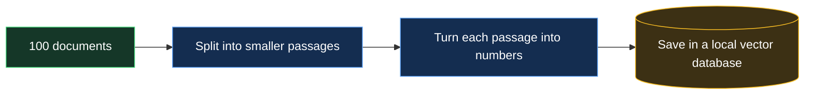

# Our first RAG experiment

## What are we trying to learn?

**Can we find the right passages in 100 documents? Then, can we make that search better, faster, or cheaper?**

We will use documents and test questions from [LegalBench-RAG](https://github.com/ZeroEntropy-AI/legalbenchrag). Start with normal RAG. Graph RAG and ontology-guided RAG come later, once we understand this first version.

## 1. First, prepare 100 documents for search

This preparation is called **ingestion**. It happens before anyone asks a question.

- **Documents:** choose the first 100 text files after sorting their paths. Copy them into one local data folder, keeping their original paths. Save the list so every experiment uses the same documents.
- **Passages, or chunks:** split long documents into smaller pieces. We want to find the relevant paragraph, rather than return a whole contract.
- **Embeddings:** turn each passage into a list of numbers representing its meaning. Similar meanings should have similar numbers. All these lists together form our “vector space.”
- **Vector database:** saves those numbers with the passage text and where it came from, so we can search them later. A local store is enough for this experiment.

For each passage, keep its original document path and start/end character positions. This lets us open the source and check whether we found the right text. Keep the original text unchanged.

**So, do we create the vector database first?** We choose the storage during setup, but filling it comes after reading, splitting, and embedding the documents. The database stores the searchable material; the embedding model creates the numbers.

## 2. Then, ask a question and retrieve passages

Use the same embedding model for passages and questions. Our first working result is a question with five retrieved passages and references back to their source text.

Later, an LLM can read those passages and write an answer. First, we need to know whether search brings back the right evidence.

## 3. Improve one thing at a time

An **index** is a way to organize saved data for searching. It is different from an embedding: the embedding describes meaning; the index helps search through the saved numbers.

Start by comparing the question with every saved vector. This gives us a simple reference result. Then try a faster vector index and see whether it saves time or misses useful passages. With only 100 documents, the simpler search may already be fast enough.

After that, try other changes separately: smaller passages, returning more passages, a different embedding model, or adding keyword search.

We do not rebuild everything for every change. A new search index can reuse the saved embeddings. Changing passage boundaries or the embedding model means creating new embeddings. Returning more results only changes the search step.

## 4. How will we know what improved?

Use the benchmark questions whose expected passages are all inside our selected 100 documents. Save that question list too. If there are too few, adjust the document selection once before starting comparisons.

| Measure | Simple meaning |
| --- | --- |
| Recall | How much of the expected evidence did we find? |
| Precision | How much of the text we returned was relevant? |
| Preparation time and cost | What did it take to make the documents searchable? |
| Search time and cost | What does each question take? |
| Storage and failures | How much space do we need, and what failed? |

LegalBench-RAG checks retrieved text against marked source passages. Its precision and recall are based on text overlap, not whether an LLM wrote a good answer. These first results describe our 100-document experiment only.

Keep one results table: **what changed, recall, precision, preparation time/cost, search time/cost, and storage**. Keep the same documents and test questions for every comparison. Use separate practice questions to choose settings, so we do not tune everything to the final test.

## Our first milestone

**100 documents → saved passage embeddings → one question → five retrieved passages → a first quality, time, and cost report.**

Choose one local vector store, one embedding model, and one passage size during implementation. Get this first version working before adding more indexing methods or other kinds of RAG.
