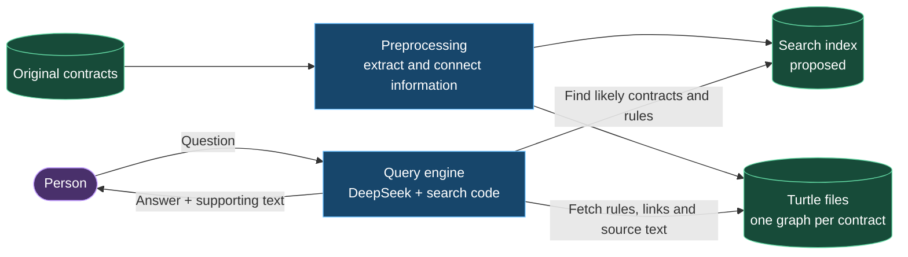
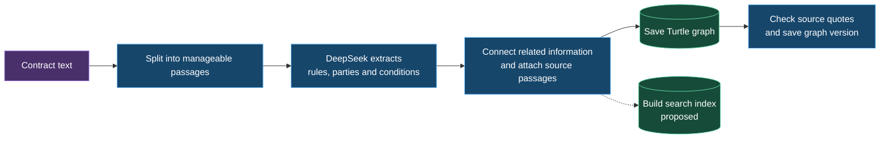
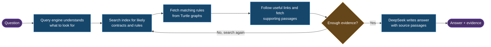

# Contract search: simple system design

**Goal:** Ask a question across contracts and receive an answer with the exact supporting contract text.

This document shows the **proposed end-to-end design**. Our experiment already builds and searches Turtle graphs, but it currently receives the correct contract in advance. Searching across all contracts is still to be built and tested.

## 1. The main components

The **query engine** is the coordinator. DeepSeek helps decide what to look for; ordinary code fetches information from the index and graph. The index helps narrow the search; Turtle stores the graph and its links back to the original passages.

## 2. Before questions: prepare the contracts

For example, a rule might say **“Either party may terminate with 30 days' notice”**, linked to the parties, the notice condition, and the exact passage it came from. Source checks confirm the quotation exists; the extracted meaning and relationships can still be wrong or incomplete.

## 3. When a question arrives

Example: **“What notice is needed to terminate the Acme agreement?”** The engine looks for the Acme agreement and termination rules, then follows any notice or exception links and returns the relevant original text. If evidence remains missing after a limited number of searches, it should say so instead of guessing.

## What exists today and what comes next

| Part | Today | Proposed next step |
|---|---|---|
| Prepare graphs | DeepSeek creates Turtle graphs with source passages. | Improve extraction as we find gaps. |
| Find a contract | The experiment is given the correct contract. | Search an index to find likely contracts across all documents. |
| Find rules | Code reads one Turtle graph and sends DeepSeek a short directory of **all its rules**. | Find a small set of likely rules first; the search method and index technology still need testing. |
| Follow links | Code fetches selected rules, nearby relationships and source passages; DeepSeek can inspect again. | Check whether relevant conditions or exceptions were missed. |
| Answer | DeepSeek answers from retrieved passages. | Show sources and clearly report missing evidence. |

**Why change rule lookup?** Today, the full rule directory must fit within 20,000 characters. Larger graphs fail before the search begins. An index is a proposed way to find candidates without sending the entire directory to the model. It may still miss a relevant rule, so we must measure recall and inspect failures.

**Storage choice:** Turtle files are sufficient for the current small experiment. A graph database or PostgreSQL search index can be considered when we test lookup across more graphs; neither is required simply to make a graph correct.

**How we test:** Keep the same saved graphs and benchmark questions. Compare normal RAG and graph search on evidence recall, precision, time, cost and failures. First use known contracts to test rule lookup; then test finding the right contract across the full collection. Character overlap does not prove the final legal answer is correct.
